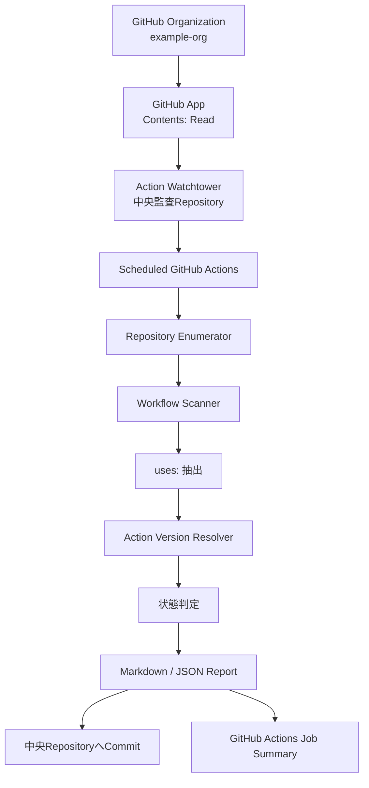
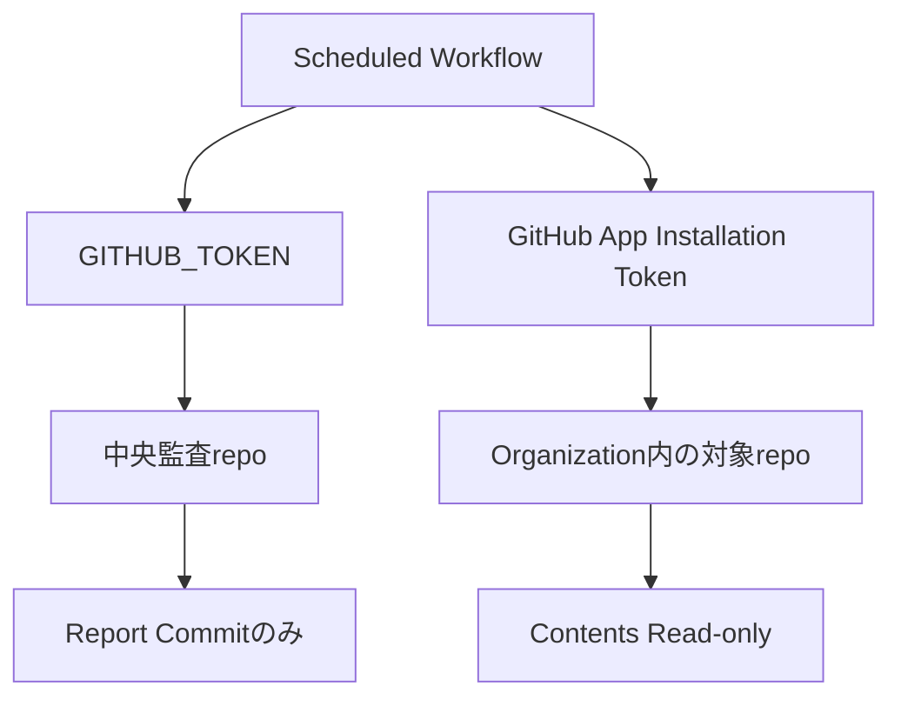
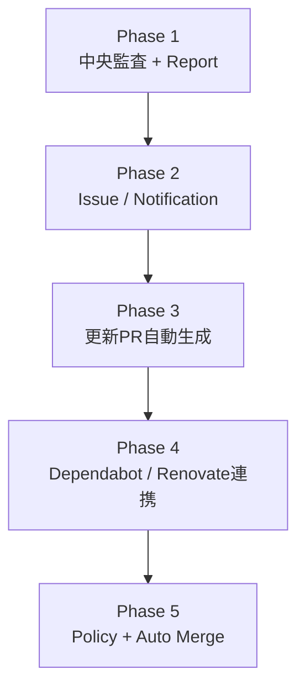

# GitHub Actions Version Watchtower 企画書

- 文書ID: `01_project_proposal`
- プロジェクト名: **Yellow-Talisman**
- 対象Organization: `example-org`
- 作成日: 2026-08-20
- ステータス: 採用済み企画と到達目標（現行照合: 2026-09-03）

現行の提供範囲、決定根拠、元の企画との未解決の差は[現行仕様の照合表](05_current_specification.md)を参照してください。本書のAction名・バージョン・件数は説明例であり、現在の最新版や実測値を宣言するものではありません。

---

## 1. エグゼクティブサマリー

`example-org` 配下のGitHubリポジトリを定期巡回し、各リポジトリの `.github/workflows/*.yml` / `*.yaml` に記述された外部GitHub Actionsの参照バージョンを収集し、上流Actionの最新安定版と比較して、**Organization全体の「古いAction利用状況」を1枚のMarkdownレポートに集約する**。

たとえば以下のような状態を、人手でリポジトリを開かずに検知する。

- `actions/checkout@v3` を使用しているが、現行の安定メジャーは `v7`
- `actions/setup-python@v5` を使用しているが、新しい安定メジャーが存在する
- 存在しないrefを参照している（当初の到達目標。現行の検査範囲との差は[未解決S-03](05_current_specification.md#s-03参照の実在確認とcurrentの意味)）
- `@main` のような可変ブランチを参照している
- SHA固定、メジャータグ固定、完全SemVer固定など、参照方式が混在している

第1段階では**監査とレポートのみ**を行い、対象リポジトリには書き込まない。  
第2段階以降で、Issue通知、更新PR作成、Dependabot/Renovate連携を追加できる構造とする。

---

## 2. 背景

GitHub ActionsのActionは、Node.jsランタイム更新やセキュリティ対応などに伴ってメジャーバージョンが更新される。

古いActionがすぐ動かなくなるとは限らないため、以下のような状態が起きやすい。

1. 古いActionを使い続ける
2. GitHub Actions実行時にAnnotationやdeprecation warningが出る
3. その時点で初めて人間が気づく
4. 他のリポジトリにも同じ古いActionが残っていないか確認する必要が生じる
5. リポジトリ数の増加に比例して巡回作業が増える

この方式は、リポジトリが増えるほど保守コストが直線的に増える。

### 現状の問題を式にすると

```text
保守負荷 ≒ リポジトリ数 × Workflow数 × 使用Action数 × 確認頻度
```

人間がこの掛け算を担当する必要はない。

---

## 3. 企画目的

### 3.1 主目的

Organization全体について、GitHub Actions依存関係の「古さ」を中央監視する。

### 3.2 具体的な到達点

中央監査リポジトリに以下のようなレポートを自動生成する。

```text
reports/github-actions.md
```

例:

| Repository | Workflow | Action | Current Ref | Latest Stable | Status |
|---|---|---|---|---|---|
| sample-repo-a | update-log.yml | actions/checkout | v3 | v7.x | 🔴 MAJOR_OUTDATED |
| sample-repo-b | main.yml | actions/checkout | v3 | v7.x | 🔴 MAJOR_OUTDATED |
| Repo-C | test.yml | actions/setup-python | v6 | v6.x | 🟢 CURRENT |

### 3.3 副目的

- 新規リポジトリが増えても中央監査側を原則変更しない
- private repositoryも対象にできる
- 対象リポジトリには原則Read-onlyでアクセスする
- LLMの記憶ではなくGitHub上の実データで判定する
- 後から自動PR作成機能を追加できる

---

## 4. 非目的

v1では以下を行わない。

- 対象リポジトリへの自動修正
- 自動マージ
- SemVer非互換変更の安全性判断
- Actionのコード品質評価
- Action自体が悪意あるものかの判定
- npm / pip / DockerなどGitHub Actions以外の依存関係監査
- SHA固定参照について「最新リリースのSHAと同一か」を完全追跡する高度判定

これらは将来拡張とする。

---

## 5. 提案方式

> **参照:** 本章および第6章では採用方式と比較候補の概要を示す。方式選定の詳細な比較、採否理由、および正式なアーキテクチャ判断については [`04_adr.md`](04_adr.md) の ADR-001 を参照。

### 5.1 全体像



### 5.2 中央管理方式を採用する理由

各リポジトリにDependabotを設定する方式も有効だが、設定ファイルを各repoへ配布・維持する必要がある。

中央監査方式では、GitHub AppをOrganizationへインストールし、アクセス可能なrepoを自動列挙するため、**repo追加時の監査設定追加を原則ゼロにできる**。

---

## 6. 方式比較

| 方式 | 長所 | 短所 | 今回の位置づけ |
|---|---|---|---|
| 各repoにDependabot | GitHub公式、自動PRまで可能 | 各repoに設定が必要、全体一覧が弱い | 将来併用 |
| 中央監査Action | 全repoを一括可視化、対象repoはRead-only | 自作が必要 | **Phase 1で採用** |
| Renovate Bot | 多repo自動更新に非常に強い | 導入・権限・ポリシー設計が増える | v2/v3候補 |
| 人手巡回 | 導入不要 | リポジトリ増加とともに破綻 | 廃止対象 |

---

## 7. v1 スコープ

### 7.1 対象

- `example-org` 内でGitHub Appからアクセス可能なrepo
- private / public repository
- default branch
- `.github/workflows/*.yml`
- `.github/workflows/*.yaml`

### 7.2 初期除外

現行はarchived / forkを既定で除外し、CLIで変更できます。本番Workflowは既定値で実行します。元の除外方針は以下です。

- archived repository
- fork repository
- 明示的に除外したrepo（現行はCLIの`--exclude`。設定ファイルの要求との差は[未解決S-01](05_current_specification.md#s-01設定ファイルとoverride-schema)）
- local action (`uses: ./...`)
- Docker action (`uses: docker://...`)

### 7.3 監査対象ref

以下を識別する。

- major tag: `@v7`
- full SemVer: `@v7.0.1`
- shortened SemVer: `@v7.0`（元の対象指定。現行の数値比較は未対応、[未解決S-02](05_current_specification.md#s-02短縮semverの扱い)）
- branch: `@main`
- SHA
- arbitrary tag

---

## 8. 判定方針

単純に文字列比較はしない。

たとえば、

```text
使用中: actions/checkout@v7
最新Release: v7.0.1
```

の場合、`v7` は「v7系へ追随するメジャータグ」であるため、**v7.0.1より古いとは判定しない**。

### v1の主要ステータス

| Status | 意味 | 重要度 |
|---|---|---|
| `CURRENT` | 現行比較で、取得した最新安定候補より古いと判定されない | 🟢 |
| `PATCH_OUTDATED` | 完全SemVer固定でpatch更新あり | 🟡 |
| `MINOR_OUTDATED` | 完全SemVer固定でminor更新あり | 🟠 |
| `MAJOR_OUTDATED` | より新しい安定メジャーあり | 🔴 |
| `FLOATING_BRANCH` | `main` 等を参照 | ⚠️ |
| `SHA_PINNED` | SHA固定。v1では鮮度判定保留 | 🔵 |
| `UNKNOWN_REF` | 判定不能なref | ⚪ |
| `UNRESOLVABLE` | 上流情報の取得・数値比較に必要な情報を解決できない | ❌ |

---

## 9. GitHub認証方針

### 9.1 対象repoの読み取り

専用GitHub Appを作成する。

推奨権限:

```text
Repository permissions
  Contents: Read-only
  Metadata: Read-only
```

対象repoにWrite権限を与えない。

### 9.2 中央repoへのレポート書き込み

中央repo自身の `GITHUB_TOKEN` を使い、

```yaml
permissions:
  contents: write
```

をそのJobにだけ付与する。

### 9.3 認証分離



これにより、監査対象repoへの誤書き込みリスクを大幅に下げる。

---

## 10. レポート戦略

### 10.1 バージョン管理対象

- `reports/github-actions.md`
- `reports/github-actions.json`

### 10.2 毎回コミットしない

実行日時だけが変化して毎週コミットされるのはノイズになるため、Git管理するレポートには「実行時刻だけの差分」を入れない。

**検出結果が変化した場合だけcommitする。**

元の要求「毎回の実行日時・スキャン件数は `$GITHUB_STEP_SUMMARY` に出力する」を維持します。現行はスキャン件数・API統計等を出力しますが、実行日時はJob Summaryに出力していません。運用上はActions runの記録から確認できますが、それを正式な代替とする決定は確認できていません。この差は[未解決S-07](05_current_specification.md#s-07job-summaryの実行日時)で追跡します。

### 10.3 Reportの優先表示

以下は企画時の7項目の相対的な優先順です。現行実装はこの順を維持し、順位未記載だった`UNKNOWN_REF`を`UNRESOLVABLE`と同じ未解決参照の区分に表示します。また、Issue #40で追加した`INVALID_REF`を先頭の独立区分に表示します。現行9種類の実際の順序・severityは[照合表第4章](05_current_specification.md#4-reportの現行表示)を参照してください。

1. MAJOR_OUTDATED
2. UNRESOLVABLE
3. MINOR_OUTDATED
4. PATCH_OUTDATED
5. FLOATING_BRANCH
6. SHA_PINNED
7. CURRENT

---

## 11. 運用頻度

ADRで採用した基本方針:

```text
毎週1回 + workflow_dispatch
```

理由:

- Actionのメジャー更新は分単位で追う必要がない
- API負荷を抑えられる
- 手動監査もいつでも可能
- 問題発生時は即座に再スキャンできる

現行の予定は日曜04:17 `Asia/Tokyo`です。設定は[本番Workflow](../.github/workflows/audit.yml)にあります。dailyへの変更は将来の判断であり、現在の頻度ではありません。

---

## 12. 成功指標

### 必須KPI

以下は到達目標です。受入チェック済みという記録だけから、検出率や数百repoの性能を実測済みとみなさないでください。検証条件・根拠の不足は[未解決S-06](05_current_specification.md#s-06数百repositoryとkpiの検証根拠)に記録しています。

- 対象repoの95%以上を正常スキャン
- `.github/workflows` を持つrepoを100%検出
- 同一Actionを複数repoで使っていてもversion lookupを重複実行しない
- major outdatedを期待通り検出
- 監査対象repoへのWrite権限ゼロ
- 結果不変時は不要なreport commitを作らない

### 利用上の成功条件

人間が確認する場所を、

```text
N個のRepository
```

から、

```text
reports/github-actions.md 1枚
```

へ縮約できること。

---

## 13. リスクと対策

| リスク | 対策 |
|---|---|
| ActionがGitHub Releaseを使っていない | Tagsへfallback |
| SemVerでないタグしかない | 現行はref分類に応じUNKNOWN_REF / UNRESOLVABLE等で可視化。overrideは未実装 |
| API rate limit | action repoをdeduplicate、conditional request/キャッシュを将来追加 |
| 巨大repo | `.github/workflows` のみContents APIで取得 |
| private repoを読めない | GitHub App installation対象を確認 |
| GitHub App秘密鍵漏えい | Actions Secret、Read-only権限、ログへ出さない |
| レポート自体のActionが古くなる | Watchtower自身も監査対象に含める |
| prereleaseを最新版扱いしてしまう | draft / prerelease除外 |
| `@v7` と `v7.0.1` を誤比較 | ref type別の比較規則を実装 |

---

## 14. 将来ロードマップ



### Phase 1
監査のみ。今回のWBSで完遂する本体。

### Phase 2
新規のMAJOR_OUTDATEDが発生した時だけIssueを作る。

### Phase 3
安全と判断した更新についてPRを作る。

### Phase 4
更新エンジンをDependabot/Renovateへ委譲し、Watchtowerは全体監査・可視化に専念する。

### Phase 5
patch/minorの自動マージなどをポリシー化する。

---

## 15. コスト感

追加サーバーは不要。

主な実行資源:

- GitHub Actions runner
- GitHub REST API
- GitHub App
- 中央監査repository

通常規模の個人/小規模Organizationであれば、週1回の監査は軽量な部類に入る。  
ただしGitHub Actionsの課金・private repositoryの利用枠は契約プランに従うため、実装時に実測する。

---

## 16. Go / No-Go 判断

### Go条件

- OrganizationへGitHub Appをインストールできる
- 中央監査repoを1つ用意できる
- 対象repoのContents readを許容できる

### No-Go条件

- Organization内repoへの一括Read権限をGitHub Appへ与えられない
- レポートを中央repoへ保存できない

今回の用途では技術的な障壁は低く、**Go推奨**。

---

## 17. 最終成果物

Phase 1の現行ファイル配置は[README](../README.md#repository-layout)、提供範囲と受入記録は[現行仕様の照合表](05_current_specification.md#2-現在の提供範囲と根拠)を参照してください。

元の構成案には`config/watchtower.yml`が含まれていましたが、現行版にはありません。設定の要求を解消済みとはせず、S-01で追跡します。運用書は[日本語](operations_ja.md)と[English](operations.md)の両方が存在します。
