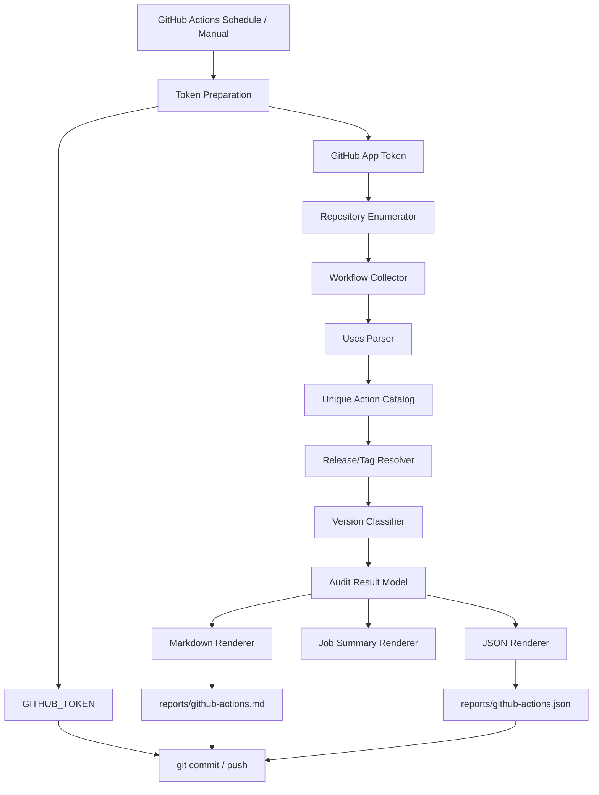
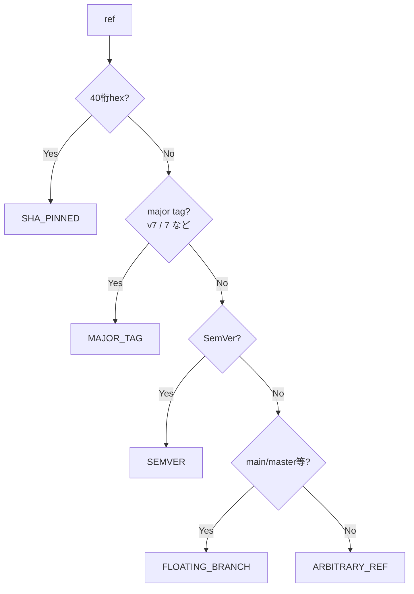
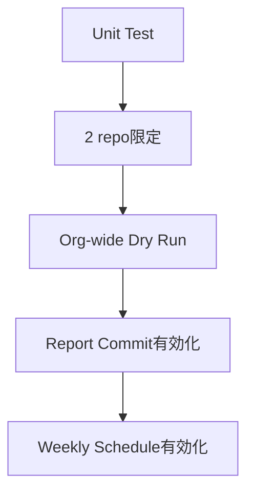

# GitHub Actions Version Watchtower 設計文書

- 文書ID: `02_system_design`
- プロジェクト名: **Yellow-Talisman**
- 対象: `example-org`
- 作成日: 2026-08-20
- 設計レベル: Phase 1の要求・設計と現行実装の対応
- 現行照合: 2026-09-03、[現行仕様の照合表](05_current_specification.md)を参照

---

本書には現行の要求・設計に加え、元の概念例と将来構想が含まれます。実装との対応・決定根拠・未解決事項は[現行仕様の照合表](05_current_specification.md)を参照してください。未解決の差は、実装の記載だけで要求を廃止したことにはなりません。Actionのバージョン例は比較規則の説明用であり、現在の最新版を宣言するものではありません。

## 1. 設計目標

Organization内の複数GitHub repositoryを中央から読み取り、Workflowで使用される外部GitHub Actionsのrefを抽出し、上流Actionの最新安定版と比較して、監査結果をMarkdown/JSONへ出力する。

設計上の最重要原則は以下。

1. **対象repoはRead-only**
2. **判定はGitHub上の実データを使用**
3. **最新バージョン取得はAction単位でdeduplicate**
4. **`@v7` と `@v7.0.1` を同じ方式で比較しない**
5. **監査に失敗したrepoを黙って無視しない**
6. **結果が変わらない限りGit履歴を汚さない**
7. **Watchtower自身も監査対象にできる**

---

## 2. 機能要件

### FR-01 Repository列挙
GitHub App installationからアクセス可能なrepositoryをページングして列挙する。

### FR-02 Repositoryフィルタ
元の要求は、以下をconfigで制御可能にすることです。現行の`audit` CLIは対応する引数を提供しますが、設定ファイルは未実装です。設定方式とschemaの扱いは[未解決S-01](05_current_specification.md#s-01設定ファイルとoverride-schema)として追跡します。

- archived repoを含む/除外
- forkを含む/除外
- include repositories
- exclude repositories

### FR-03 Workflow検出
各repoのdefault branchから、

```text
.github/workflows/*.yml
.github/workflows/*.yaml
```

を取得する。

### FR-04 `uses:` 抽出
Workflow内のAction/reusable workflow参照を行単位で検出する。

### FR-05 外部Action識別
以下の形式をActionとして扱う。

```text
owner/repo@ref
owner/repo/path/to/action@ref
```

### FR-06 除外識別
以下はAction version監査から除外または別カテゴリ化する。

```text
./local-action
docker://image:tag
```

### FR-07 Version情報取得
Action repositoryから安定releaseを取得する。ReleaseでSemVer候補が得られない場合はtagへfallbackする。

### FR-08 Version比較
ref形式別ルールで状態を判定する。

### FR-09 Markdown report
人間が読む一覧を生成する。

### FR-10 JSON report
将来のBot処理に使える機械可読データを生成する。

### FR-11 Job Summary
毎回の実行結果をActions画面に表示する。

### FR-12 差分commit
監査結果に実質差分がある時だけreportをcommitする。

---

## 3. 非機能要件

### NFR-01 Security
対象repoにwrite permissionを与えない。

### NFR-02 Determinism
同じ入力から同じreport本文を生成する。実行時刻だけで差分を作らない。

### NFR-03 Scalability
少なくとも数百repo程度まで、GitHub REST API rate limit内で運用可能な構造にする。

### NFR-04 Observability
repo単位/API単位のエラーを最終summaryに残す。

### NFR-05 Fault tolerance
1 repoの読み込み失敗で全監査を即終了しない。ただし認証失敗など全体障害はFailする。

### NFR-06 Testability
GitHub APIアクセス層、parser、version resolver、report rendererを分離する。

---

## 4. システム構成



---

## 5. Repository構成

現行の配置は[README](../README.md#repository-layout)を参照してください。

| 配置 | 内容 |
|---|---|
| `scripts/` | API、Models、Collector、Parser、Scanner、Resolver、Report、audit、dry-run |
| `tests/` | 各部品とWorkflowのテスト、fixtures |
| `.github/workflows/` | 本番audit、認証・部品Gate、限定・Organization全体dry-run |
| `reports/` | 最新の監査結果を表すMarkdown / JSON |
| `config/` | placeholderのみ。元の計画の`watchtower.yml`は存在しない |
| `docs/` | 企画・設計・WBS・ADR・現行仕様照合表・英日運用書 |

元の構成例にあった`workflow_checkout_v3.yml`等は個別ファイルとしては存在しません。実際の入力はテスト内のデータと`tests/fixtures/`にあります。Pythonは標準ライブラリ中心とし、追加の依存パッケージを極力減らす方針です。現行実装は標準ライブラリを使用します。

---

## 6. 認証設計

### 6.1 GitHub App

設計時のApp名の例は`example-org-action-watchtower`です。実際のAppの表示名・installation設定はGitHub側で確認します。以下は必要な権限であり、実設定をソースだけで確認できるという意味ではありません。

Repository permissions:

| Permission | Level | 用途 |
|---|---:|---|
| Metadata | Read | repo情報 |
| Contents | Read | Workflow内容取得 |

Organization permissionは原則追加しない。

GitHub Appは `example-org` へインストールする。

初期運用では「All repositories」が最も管理負荷が低い。  
権限を狭くしたい場合はSelected repositoriesでもよいが、新規repo追加時の手作業が発生する。

### 6.2 Secret / Variable

中央repo:

```text
Actions Variable
  WATCHTOWER_APP_CLIENT_ID

Actions Secret
  WATCHTOWER_APP_PRIVATE_KEY
```

秘密鍵はbase64へ変換する必要がない方式を優先する。

### 6.3 Tokenの役割分離

```text
App installation token
  → target repositories READ

GITHUB_TOKEN
  → Yellow-Talisman自身 WRITE
```

App tokenでreportをpushしない。  
GITHUB_TOKENで他repoを読もうとしない。

---

## 7. Workflow設計

現行の実行定義は[`.github/workflows/audit.yml`](../.github/workflows/audit.yml)を正本とします。PR #22でjobごとの権限分離を実装し、PR #26でscheduleを追加しました。

| 項目 | 現行の構成 |
|---|---|
| 起動 | `workflow_dispatch`と日曜04:17 `Asia/Tokyo`のschedule |
| Workflow権限 | 最上位は`permissions: {}` |
| `audit` job | read-only App tokenを発行し、そのtokenでcheckout・監査。`persist-credentials: false` |
| 監査コマンド | `python3 -m scripts.audit`。フィルタ引数なし |
| 中間受け渡し | Markdown / JSONをartifactへ保存 |
| `commit-report` job | `needs: audit`、中央repoだけ`contents: write`。`main`をcheckoutし、artifactを取得 |
| commit対象 | `reports/github-actions.md`と`reports/github-actions.json`だけ |
| 変更なし | 正常終了し、commit / pushを省略 |
| 変更あり | `GITHUB_TOKEN`経路で中央repoの`main`へcommit / push |

旧版の単一jobのYAMLは概念例でした。現在の設定として使わないよう、実装への参照に置き換えています。Actionの採用バージョンはWorkflow内で管理し、更新時には公式repositoryの情報を確認します。

---

## 8. Config設計

**未実装の概念例:** `config/watchtower.yml`のファイル、loader、schemaは現行版に存在しません。以下を置いても本番監査には反映されません。現行CLIと本番Workflowの設定入口は[照合表第3章](05_current_specification.md#3-設定と実行経路)を参照してください。

元の設定ファイル案:

```yaml
organization: example-org

repositories:
  include: []
  exclude:
    - example-repo-to-ignore

filters:
  include_archived: false
  include_forks: false

version_policy:
  include_prerelease: false
  report_floating_branches: true
  report_sha_pins: true

report:
  markdown: reports/github-actions.md
  json: reports/github-actions.json

overrides:
  actions: {}
```

### override将来例

```yaml
overrides:
  actions:
    owner/special-action:
      version_regex: '^release-(\d+)$'
```

元の要求「v1でoverride実装を最小限にしてもよいが、schemaだけ確保する」は、現行実装と一致していません。MVPのoverride延期とPhase 1のschema要否を区別し、[未解決S-01](05_current_specification.md#s-01設定ファイルとoverride-schema)で判断を追跡します。

---

## 9. GitHub API設計

### 9.1 Repository列挙

現行で利用するAPI:

```text
GET /installation/repositories
```

理由:

- GitHub Appが実際にアクセスできるrepoだけ列挙できる
- private repoを含む
- Organization設定と実アクセス範囲のズレを減らせる

元の代替案`GET /orgs/{org}/repos`は現行では利用していません。

### 9.2 Workflow directory

各repoについて:

```text
GET /repos/{owner}/{repo}/contents/.github/workflows?ref={default_branch}
```

404の場合:

```text
NO_WORKFLOWS
```

という概念上の正常ケースです。現行では空の一覧を返し、`NO_WORKFLOWS`という公開statusやerrorは出しません。Issue #3の決定に対応します。

### 9.3 Workflow file

directory listingで得た `.yml` / `.yaml` のみ取得。

```text
GET /repos/{owner}/{repo}/contents/{path}?ref={default_branch}
```

raw media typeを利用する。

### 9.4 Action release

まず:

```text
GET /repos/{owner}/{action-repo}/releases?per_page=100
```

draft / prereleaseを除外しSemVerを抽出。

有効な安定releaseがない場合:

```text
GET /repos/{owner}/{action-repo}/tags?per_page=100
```

へfallback。

---

## 10. API効率設計

悪い実装:

```text
Repo A checkout@v3 → checkout release lookup
Repo B checkout@v3 → checkout release lookup
Repo C checkout@v7 → checkout release lookup
```

良い実装:

```text
全Workflowを先に収集
        ↓
actions/checkout を1つへdeduplicate
        ↓
release lookup 1回
        ↓
全usageへ結果を配布
```

### 想定リクエスト量

概算:

```text
1                              installation repo一覧
+ repository数                  workflow directory一覧
+ workflow file数               workflow本文
+ unique action repo数 × 1〜2   release/tag情報
```

これは設計時の概算です。pagination、branch照会、retryは追加リクエストとなり、数百repoでの実測保証ではありません。検証根拠は[未解決S-06](05_current_specification.md#s-06数百repositoryとkpiの検証根拠)を参照してください。

---

## 11. Parser設計

### 11.1 抽出対象

例:

```yaml
- uses: actions/checkout@v7
- uses: actions/setup-python@v6
- uses: docker/setup-buildx-action@v3
```

また、job-level reusable workflow:

```yaml
uses: owner/repo/.github/workflows/build.yml@v2
```

も検出自体は行う。

### 11.2 正規化モデル

```python
ActionUsage(
    source_repository="example-org/sample-repo-b",
    workflow_path=".github/workflows/main.yml",
    line_number=18,
    raw="actions/checkout@v3",
    action_repository="actions/checkout",
    subpath=None,
    ref="v3",
    kind="github_action",
)
```

subpath例:

```text
owner/repo/path/to/action@v2
```

↓

```text
action_repository = owner/repo
subpath = path/to/action
```

### 11.3 解析方式

現行実装は`uses:`行を対象にしたline parserです。Workflow本文は実行しません。YAML全体の意味検証や、呼び出し先reusable workflow本文の再帰走査は行いません。具体的な対応例は[Parserテスト](../tests/test_parser.py)を参照してください。

理由:

- Workflow全体をYAML objectへ変換する必要がない
- `${{ ... }}` 等のGitHub式に干渉しにくい
- line numberをそのまま保持できる
- PyYAML依存を増やさずに済む

### 11.4 除外

```text
./
../
docker://
```

はversion resolverへ渡さない。

---

## 12. Ref分類

静的分類とbranch判定を説明する概念図です。現行では先に上流catalogを取得し、取得不能なら`UNRESOLVABLE`を優先します。静的分類できないrefは`main` / `master`を含めbranchの実在をAPIで確認し、存在すれば`FLOATING_BRANCH`、なければ`UNKNOWN_REF`にします。さらに、最新安定版より新しい数値ref（major tag / 完全SemVer）はGitHub APIで同名Tagの実在を検査し、Tagがなくても同名Branchがあれば`FLOATING_BRANCH`、どちらもなければ`INVALID_REF`と判定します。最新安定版以下の数値refやSHAの実在までは検査しません。図は構文分類の概念図であり、この追加の実在確認や公開statusまで網羅するものではありません。図中の`MAJOR_TAG`等は分類名であり、公開statusとは異なります。



SHA長は将来GitHub側仕様変更を考慮してconfig化してもよいが、v1では40-hexを基本とする。

---

## 13. Version Resolver設計

### 13.1 Stable version

release候補:

- `draft == false`
- `prerelease == false`
- tag名からSemVer抽出可能

例:

```text
v7.0.1 → 7.0.1
7.0.1  → 7.0.1
```

### 13.2 Pre-release除外

以下はv1の「latest stable」から除外:

```text
v8.0.0-beta.1
v8.0.0-rc.2
```

### 13.3 releaseが存在しないAction

tag一覧からSemVer候補を探す。

### 13.4 SemVer候補がない

元の`NO_VERSION_INFO`は概念上の名称です。Issue #4で当初の実装statusは8種類に整理されました。その後Issue #40で未来数値refの`INVALID_REF`を加え、現行は9種類です。`NO_VERSION_INFO`は公開statusではありません。

数値比較するmajor tag / 完全SemVerで候補が得られない場合は`UNRESOLVABLE`です。上流自体を取得できる場合のSHAは`SHA_PINNED`、branch / 任意refはbranch照会に応じた分類になります。[実装とテストの索引](05_current_specification.md#5-frnfrと実装の対応)を参照してください。

---

## 14. 比較規則

以下は比較例です。現行の`CURRENT`は取得した候補より古いと判定されないことを表し、すべてのrefの実在・安全性・互換性を保証しません。最新安定候補より大きい数値refについては同名Tag / Branchの存在を確認し、両方存在しなければ`INVALID_REF`です。短縮SemVerと残りのref実在確認の要求差は[未解決事項](05_current_specification.md#6-未解決の仕様差)を参照してください。

### 14.1 Major tag

```text
current = v7
latest = v7.0.1
```

結果:

```text
CURRENT
```

比較対象はmajor number。

```text
current = v3
latest = v7.0.1
```

結果:

```text
MAJOR_OUTDATED
```

### 14.2 Full SemVer

```text
current = v7.0.0
latest = v7.0.1
```

→ `PATCH_OUTDATED`

```text
current = v7.0.0
latest = v7.2.0
```

→ `MINOR_OUTDATED`

```text
current = v6.5.0
latest = v7.0.1
```

→ `MAJOR_OUTDATED`

### 14.3 SHA

v1:

```text
SHA_PINNED
```

「安全な固定方法である可能性が高いが、鮮度は未判定」と明示する。

SHAがどのrelease/tag commitかを追跡する機能は将来構想です。実施時期は別Issueで決めます。ADRの将来ロードマップではPhase 5の候補であり、Phase 2で実装済みという意味ではありません。

### 14.4 Branch

```text
@main
@master
```

→ `FLOATING_BRANCH`

「最新版追随」という意味では常に新しい可能性があるが、再現性・supply chain上の別問題としてWarning扱い。

### 14.5 Arbitrary ref

```text
@stable
@node24
@release
```

→ `UNKNOWN_REF`

これらの名前でも実在するbranchなら`FLOATING_BRANCH`となります。overrideによる別規則は未実装の構想です。

---

## 15. データモデル

以下のJSONは設計時の概念例であり、現行の全フィールドや公開keyを定義するschemaではありません。ScannerのJSON Linesは`ActionUsage.to_dict()`、ReportのJSONは`AuditFinding.to_dict()`等と`render_json()`に対応します。[models.py](../scripts/models.py)と[Reportテスト](../tests/test_report.py)を参照してください。

### 15.1 Usage

```json
{
  "source_repository": "example-org/sample-repo-b",
  "workflow": ".github/workflows/main.yml",
  "line": 18,
  "action": "actions/checkout",
  "subpath": null,
  "ref": "v3",
  "ref_type": "major"
}
```

### 15.2 ActionCatalog

```json
{
  "action": "actions/checkout",
  "latest_stable": "v7.0.1",
  "latest_major": 7,
  "source": "release"
}
```

### 15.3 AuditFinding

```json
{
  "source_repository": "example-org/sample-repo-b",
  "workflow": ".github/workflows/main.yml",
  "line": 18,
  "action": "actions/checkout",
  "current_ref": "v3",
  "latest_stable": "v7.0.1",
  "status": "MAJOR_OUTDATED",
  "severity": "high"
}
```

---

## 16. Report設計

この章の断片は説明用です。現行のstatus表示順・severity・区分は[照合表第4章](05_current_specification.md#4-reportの現行表示)、形式の期待値は[Reportテスト](../tests/test_report.py)を参照してください。

### 16.1 Markdown header

```markdown
# GitHub Actions Version Audit

## Summary

- Repositories scanned: 42
- Workflow files scanned: 87
- Action usages: 163
- Unique actions: 14
- Major outdated: 6
- Errors: 0
```

### 16.2 Problems first

```markdown
## 🔴 Major updates required

| Repository | Workflow | Line | Action | Current | Latest |
```

### 16.3 Warnings

```markdown
## ⚠️ Policy warnings
```

### 16.4 Current

現行は`CURRENT`も独立した詳細表に表示します。折りたたみやrepo単位summaryは元の表示改善案で、実装されていません。

### 16.5 Errors

元の要求「アクセス不能・upstream 404・API失敗は必ず末尾へ出す」を維持します。現行は回復可能な収集・照会失敗のwarningを末尾のErrorsへ出しますが、上流Release / Tags取得の404は`UNRESOLVABLE`のfindingとして表示し、この経路だけではErrorsに記録・加算しません。数値比較情報なしもfindingとして可視化します。これは[現行動作の観測](05_current_specification.md#障害時の現行動作)であり、Errorsへの収録要求を変更する決定は確認できていません。要求との差と収録範囲の判断は[未解決S-08](05_current_specification.md#s-08errorsへの収録範囲)で追跡します。

---

## 17. JSON設計

トップレベル:

```json
{
  "schema_version": 1,
  "summary": {},
  "findings": [],
  "errors": []
}
```

時刻を含める場合、version-controlled JSONとは分離する。

`reports/github-actions.json` はdiff安定性を優先し、findingsを決定的sortする。

---

## 18. Commit設計

実行後:

```bash
git add reports/github-actions.md reports/github-actions.json
git diff --cached --quiet
```

差分なし:

```text
commitしない
workflow成功
```

差分あり:

```text
chore: update GitHub Actions audit report
```

### concurrency

同時実行によるpush競合を避ける。

```yaml
concurrency:
  group: action-watchtower-audit
  cancel-in-progress: false
```

---

## 19. Error handling

現行では次を区別します。元の「1ファイル取得失敗なら常に継続」という読み方はしません。

| 状況 | 扱い |
|---|---|
| Workflow directoryが404 | 正常な空結果。Errorsには数えない（Issue #3 / #7） |
| 一覧にあったWorkflow本文が404 | warningを残して継続 |
| 上流404・数値比較用の情報なし | 対象usageを`UNRESOLVABLE`等として可視化し継続 |
| 対象単位の回復可能なAPI失敗 | retry後も5xx・通信失敗ならwarningを保持して継続 |
| App token発行・installation一覧取得・report生成・必要なpushの失敗 | 全体または該当jobをFail |

元の全体停止条件には「API認証が全面的に401/403」とありました。現行コードは全面障害を判定せず、404以外の全4xxをfatalにします。この停止範囲の採否は[未解決S-05](05_current_specification.md#s-05全体停止するapiエラーの範囲)です。運用時は[現行動作表](05_current_specification.md#障害時の現行動作)を参照してください。

---

## 20. Retry設計

対象:

- 5xx
- network timeout
- 429 / secondary rate limit

方針:

```text
初回を含め最大3試行（既定値、再試行は最大2回）
exponential backoff
Retry-Afterがあれば優先
```

401 / 404は原則retryしない。

---

## 21. Rate Limit設計

レスポンスヘッダを監視:

```text
X-RateLimit-Remaining
X-RateLimit-Reset
```

元の要求は「remainingが閾値以下ならwarning」です。現行の本番監査はtelemetry表示までで、閾値warningは未実装です。両dry-runの余裕不足を失敗にする判定とは区別し、[未解決S-04](05_current_specification.md#s-04rate-limit閾値warning)で追跡します。

現行Resolverにはインスタンス内cacheがあります。次は将来の拡張候補です:

- ETag / If-None-Match
- 実行間で保持するcache
- incremental scan

を追加可能。

---

## 22. Security設計

### 必須

- private keyはActions Secret
- tokenをprintしない
- AppはContents Read-only
- 対象repoへwriteしない
- fork内コードを実行しない
- workflow本文は「読むだけ」
- `uses:` の内容をshell commandとして実行しない

### Supply chain

Watchtower自身のworkflowで利用する外部Actionは最小限にする。

理想:

1. checkout
2. GitHub App token発行用公式Action

という元の最小構成案です。現行はjob間でreportを渡すためartifactのupload / download Actionも使用します。Action一覧は本番Workflowを参照してください。

将来はこれら自体をfull commit SHA pinすることも検討します。

---

## 23. Test設計

### Unit Test

#### parser

- checkout@v3
- checkout@v7
- owner/repo/path@v2
- SHA
- quoted uses
- inline comment
- local action
- docker action
- reusable workflow

#### version resolver

- v3 vs v7.0.1 → MAJOR_OUTDATED
- v7 vs v7.0.1 → CURRENT
- v7.0.0 vs v7.0.1 → PATCH_OUTDATED
- v7.1.0 vs v7.2.0 → MINOR_OUTDATED
- prerelease除外
- releaseなし→tags fallback

#### report

- severity順
- repository名順
- deterministic output
- error section

### Integration Test

対象候補:

- `sample-repo-a`
- `sample-repo-b`

期待:

```text
既知の古いcheckout参照を正しく検出できる
```

既に更新済みの場合はfixture branchまたはtest fixtureで再現する。

---

## 24. Dry Run設計

以下は導入時の段階的な確認方針です。現行の本番`audit.yml`にはcommit処理とscheduleがあります。通常のdry-runは別Workflowで実行し、本番Workflowのcommit stepを削除・無効化する操作ではありません。[実行経路一覧](05_current_specification.md#3-設定と実行経路)を参照してください。

最初はreport commitを無効にし、

```text
workflow_dispatch
```

で実行。

Job Summaryとartifact/consoleで結果確認後、commitを有効化する。

本番切替順:



---

## 25. Observability

毎runでJob Summaryへ出す。

```text
Repositories scanned
Workflow files scanned
Action usages
Unique Actions
Findings by severity
Errors
API requests
Rate limit remaining
Report changed: yes/no
```

Secretやtokenは一切出さない。

---

## 26. Operations

### 通常

[運用書](operations_ja.md)に従い、runの成否、想定外のpartial errors、reportの問題項目を確認します。表示色だけで未解決参照やエラーを除外しません。

### Action更新検知時

1. upstream release notesを確認
2. major updateなら影響確認
3. 対象repoでPR作成
4. Actions成功確認
5. merge
6. 次回WatchtowerでCURRENT化を確認

### Watchtower自体が失敗した時

1. Actions run summary確認
2. auth failure / rate limit / parser failureを切り分け
3. `workflow_dispatch` で再実行

---

## 27. Phase 2以降の拡張ポイント

### Notifications

新しい`MAJOR_OUTDATED`だけ中央repoにIssue作成。

### PR generation

target repoへwrite権限を追加するのではなく、別GitHub Appまたは別installation permission設計を推奨。

Read auditorとWrite updaterを分離する。

### Dependabot

各repoへ展開する場合:

```yaml
version: 2
updates:
  - package-ecosystem: github-actions
    directory: /
    schedule:
      interval: weekly
```

Watchtowerは「中央の見える化」、Dependabotは「更新PR作成」という役割分担にする。

### Renovate

多数repoへ自動更新を展開する段階ではRenovateのautodiscoverを比較検討する。

---

## 28. Acceptance Criteria

Phase 1導入時の完成条件と受入記録です。PR #32でチェック済みに更新されています。将来構想や[未解決の仕様差](05_current_specification.md#6-未解決の仕様差)まで検証済みであることを意味しません。

- [x] GitHub Appが対象repoをRead-onlyで列挙できる
- [x] `.github/workflows` の有無を判定できる
- [x] 全`.yml/.yaml`から`uses:`を抽出できる
- [x] 同一Actionのversion lookupがdeduplicateされる
- [x] release→tag fallbackが動く
- [x] `@v3` → `MAJOR_OUTDATED` を検出できる
- [x] 最新major tagをCURRENT判定できる
- [x] prereleaseをstable latestに混ぜない
- [x] 失敗repoがreportに残る
- [x] Markdown/JSONが生成される
- [x] reportが変わらなければcommitしない
- [x] weekly scheduleとworkflow_dispatchが動く
- [x] 対象repoへのWrite権限がない
- [x] README/operations手順が存在する

---

## 29. 参考公式資料

- GitHub Actions workflow schedule  
  https://docs.github.com/en/actions/reference/workflows-and-actions/workflow-syntax

- GITHUB_TOKEN  
  https://docs.github.com/en/actions/concepts/security/github_token

- GitHub App installation authentication  
  https://docs.github.com/en/apps/creating-github-apps/authenticating-with-a-github-app/authenticating-as-a-github-app-installation

- Repository Contents API  
  https://docs.github.com/en/rest/repos/contents

- GitHub REST API rate limits  
  https://docs.github.com/en/rest/using-the-rest-api/rate-limits-for-the-rest-api

- Dependabot for GitHub Actions  
  https://docs.github.com/en/code-security/how-tos/secure-your-supply-chain/secure-your-dependencies/auto-update-actions

- actions/create-github-app-token  
  https://github.com/actions/create-github-app-token
