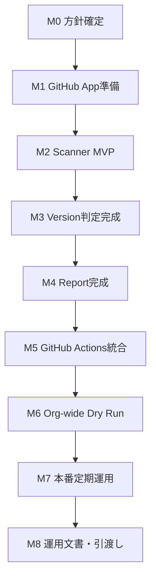
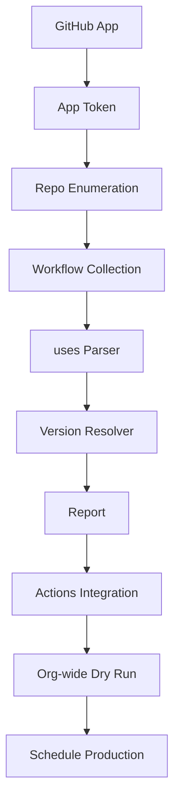

# GitHub Actions Version Watchtower 実装WBS

- 文書ID: `03_wbs`
- プロジェクト名: **Yellow-Talisman**
- 対象: `example-org`
- 作成日: 2026-08-20
- 目的: ゼロ状態からPhase 1本番運用開始までの作業・受入記録

Phase 1の各Stageの完了はTracking Issue #11に記録されています。本書の工数・MVPの省略候補・導入順は当初の計画です。現在の操作手順は[運用書](operations_ja.md)、要求と現物の対応・未解決事項は[現行仕様の照合表](05_current_specification.md)を参照してください。既存の完了チェックは新たな検証完了を意味しません。

---

## 1. 完成の定義

このWBSの完了時、以下が成立していること。

```text
毎週、自動的にexample-org配下の対象repoを監査
    ↓
Workflowで使用されるGitHub Actionsを収集
    ↓
最新安定版と比較
    ↓
中央repoのreports/github-actions.mdへ集約
    ↓
結果に変化があった時だけcommit
```

さらに `workflow_dispatch` で即時再監査できる。

対象repoへの権限はRead-only。

---

## 2. 全体マイルストーン



| Milestone | 完了条件 |
|---|---|
| M0 | スコープ・repo名・schedule決定 |
| M1 | App tokenで対象private repoを読める |
| M2 | Workflowから`uses:`一覧を抽出できる |
| M3 | major/minor/patch等を正しく分類できる |
| M4 | Markdown/JSON report生成成功 |
| M5 | workflow_dispatchでE2E成功 |
| M6 | Organization全体dry run成功 |
| M7 | schedule運用開始 |
| M8 | README/operations含めDone |

---

## 3. WBS詳細

> 工数は目安。AI支援で実装する前提なら短縮可能。  
> 「受入条件」を満たすまで次工程へ進まない。

| ID | Task | 成果物 | 受入条件 | 依存 | 目安 |
|---|---|---|---|---|---:|
| 0.1 | プロジェクト名決定 | 名称 | repo名に使える | - | 0.1h |
| 0.2 | 中央repo名決定 | `example-org/Yellow-Talisman` | 一意 | 0.1 | 0.1h |
| 0.3 | v1スコープ確定 | scope記録 | 自動PRをv1から除外 | 0.2 | 0.2h |
| 0.4 | 監査頻度決定 | schedule | weekly + manual | 0.3 | 0.1h |
| 0.5 | archived/fork方針決定 | config方針 | include/exclude確定 | 0.3 | 0.1h |
| 1.1 | 中央repo作成 | GitHub repo | main branch利用可能 | 0.x | 0.2h |
| 1.2 | 初期README作成 | README.md | 目的が記載済み | 1.1 | 0.2h |
| 1.3 | directory skeleton作成 | scripts/tests/reports/config | commit済み | 1.1 | 0.3h |
| 2.1 | GitHub App作成 | App registration | App ID取得 | 1.1 | 0.3h |
| 2.2 | App permission設定 | Contents Read | Writeなし | 2.1 | 0.2h |
| 2.3 | Appをorgへinstall | Installation | 対象repoへアクセス | 2.2 | 0.3h |
| 2.4 | Private key生成 | PEM | 安全に取得 | 2.1 | 0.2h |
| 2.5 | Client IDをActions Variableへ登録 | variable | workflowから参照可能 | 2.1 | 0.1h |
| 2.6 | Private keyをActions Secretへ登録 | secret | ログ非表示 | 2.4 | 0.1h |
| 2.7 | Token発行テスト | test workflow | installation token生成成功 | 2.3-2.6 | 0.5h |
| 2.8 | Repo一覧取得テスト | API result | private含む対象repo取得 | 2.7 | 0.4h |
| 3.1 | GitHub API client骨格 | `github_api.py` | GET + pagination | 2.8 | 0.8h |
| 3.2 | repo enumerator | 関数 | 全installation repo列挙 | 3.1 | 0.6h |
| 3.3 | repo filter | 関数 | archived/fork/exclude反映 | 3.2 | 0.4h |
| 3.4 | workflow directory collector | 関数 | `.github/workflows`列挙 | 3.1 | 0.7h |
| 3.5 | workflow file fetch | 関数 | raw YAML取得 | 3.4 | 0.5h |
| 3.6 | 404/no workflows handling | error model | 正常継続 | 3.4 | 0.3h |
| 4.1 | `uses:` parser実装 | `parser.py` | 基本形式抽出 | 3.5 | 0.8h |
| 4.2 | quoted uses対応 | parser | `'...'` / `"..."` | 4.1 | 0.3h |
| 4.3 | subpath Action対応 | parser | owner/repo/path認識 | 4.1 | 0.3h |
| 4.4 | local action除外 | parser | `./`除外 | 4.1 | 0.2h |
| 4.5 | docker action除外 | parser | `docker://`除外 | 4.1 | 0.2h |
| 4.6 | line number保持 | model | reportへ行番号出力 | 4.1 | 0.3h |
| 4.7 | parser unit tests | tests | fixture全件pass | 4.1-4.6 | 0.8h |
| 5.1 | Action repo dedup | catalog | unique action一覧 | 4.x | 0.4h |
| 5.2 | Release API client | resolver | releases取得 | 3.1 | 0.6h |
| 5.3 | stable release filter | resolver | draft/prerelease除外 | 5.2 | 0.5h |
| 5.4 | SemVer parser | resolver | vN.N.N正規化 | 5.3 | 0.7h |
| 5.5 | Tags fallback | resolver | releaseなし対応 | 5.2 | 0.6h |
| 5.6 | ref classifier | resolver | major/semver/SHA/branch | 5.4 | 0.6h |
| 5.7 | Major判定 | resolver | v3→v7=MAJOR | 5.6 | 0.4h |
| 5.8 | Major tag current判定 | resolver | v7 vs v7.0.1=CURRENT | 5.7 | 0.4h |
| 5.9 | Minor/Patch判定 | resolver | exact semver比較 | 5.7 | 0.5h |
| 5.10 | unknown/ref errors | resolver | UNKNOWN/UNRESOLVABLE | 5.6 | 0.4h |
| 5.11 | resolver unit tests | tests | 全比較ケースpass | 5.3-5.10 | 1.0h |
| 6.1 | Audit result model | `models.py` | JSON化可能 | 4.x,5.x | 0.4h |
| 6.2 | Severity sort | model | High→Low | 6.1 | 0.3h |
| 6.3 | Markdown renderer | `report.py` | 読めるreport | 6.1 | 0.9h |
| 6.4 | JSON renderer | `report.py` | schema_version付き | 6.1 | 0.5h |
| 6.5 | deterministic sort | renderer | 同入力=同出力 | 6.3-6.4 | 0.4h |
| 6.6 | report tests | tests | snapshot/expected一致 | 6.3-6.5 | 0.7h |
| 7.1 | `audit.py` orchestration | main | 全処理接続 | 3-6 | 1.0h |
| 7.2 | retry/backoff | API client | 5xx/429対応 | 3.1 | 0.6h |
| 7.3 | rate limit telemetry | summary data | remaining記録 | 3.1 | 0.3h |
| 7.4 | partial failure handling | main | 1repo失敗で継続 | 7.1 | 0.5h |
| 7.5 | exit code policy | main | fatal/nonfatal分離 | 7.4 | 0.3h |
| 8.1 | workflow_dispatch作成 | audit.yml | 手動実行可能 | 7.x | 0.6h |
| 8.2 | App token step統合 | audit.yml | org read成功 | 8.1 | 0.4h |
| 8.3 | permissions最小化 | audit.yml | central contents writeのみ | 8.1 | 0.3h |
| 8.4 | concurrency設定 | audit.yml | 同時push防止 | 8.1 | 0.2h |
| 8.5 | Job Summary出力 | summary | runごとに統計表示 | 7.1 | 0.5h |
| 8.6 | diff判定 | workflow | 無変更commitなし | 8.1 | 0.4h |
| 8.7 | report commit/push | workflow | 変更時のみpush | 8.6 | 0.5h |
| 9.1 | テスト対象repo限定実行 | dry run | 2repo程度で成功 | 8.x | 0.5h |
| 9.2 | 既知v3 fixture検証 | result | MAJOR_OUTDATED検知 | 9.1 | 0.3h |
| 9.3 | 最新major検証 | result | CURRENT誤検知なし | 9.1 | 0.3h |
| 9.4 | error injection | result | 404等で継続 | 9.1 | 0.5h |
| 10.1 | org-wide dry run | run | 全repo列挙 | 9.x | 0.5h |
| 10.2 | false positive確認 | review | 誤判定修正 | 10.1 | 1.0h |
| 10.3 | false negative確認 | review | 見落とし修正 | 10.1 | 1.0h |
| 10.4 | API request数確認 | metrics | rate limit余裕 | 10.1 | 0.3h |
| 10.5 | report初版commit | report | mainに生成 | 10.2-10.4 | 0.3h |
| 11.1 | weekly schedule追加 | audit.yml | cron登録 | 10.x | 0.2h |
| 11.2 | schedule初回run確認 | run | 自動起動成功 | 11.1 | 経過待ち |
| 11.3 | no-change run確認 | git history | 無駄commitなし | 11.2 | 0.2h |
| 12.1 | README完成 | README | setup/目的/見方 | 11.x | 0.8h |
| 12.2 | operations.md作成 | docs | 障害時手順 | 11.x | 0.8h |
| 12.3 | App権限記録 | docs | permission再現可能 | 12.1 | 0.3h |
| 12.4 | Secretローテーション手順 | docs | private key更新可能 | 12.2 | 0.4h |
| 12.5 | Acceptance checklist実施 | checklist | 全項目pass | 12.x | 0.8h |
| 12.6 | Phase 1完了タグ | release/tag | v1.0.0 | 12.5 | 0.2h |

概算実作業: **約20〜25時間相当**。  
AI支援・逐次レビューで短縮できるが、認証設定・dry run・誤判定確認は省略しない。

---

## 4. 実行順チェックリスト

### Stage 0: 企画固定

- [x] 中央repo名を決める
- [x] v1は「監査のみ」と決める
- [x] weekly + manualを基本とする
- [x] archived/forkの扱いを決める

**Gate:** スコープ変更を止めて実装へ進める。

---

### Stage 1: 中央repo

- [x] `example-org/Yellow-Talisman` repoを作る
- [x] `README.md` を置く
- [x] `scripts/`
- [x] `tests/`
- [x] `reports/`
- [x] `config/`
- [x] `.github/workflows/`

**Gate:** main branch上に骨格が存在する。

---

### Stage 2: GitHub App

- [x] GitHub Appを登録
- [x] Contents: Read-only
- [x] Organizationへinstall
- [x] 対象repoをAll repositoriesまたはSelectedで指定
- [x] Client ID取得
- [x] Private key作成
- [x] Client IDをActions Variableへ登録
- [x] Private keyをActions Secretへ登録
- [x] workflowからinstallation tokenを発行
- [x] private repoを1つ読み取る

**Gate:** App tokenで対象repoのWorkflowファイルを取得できる。

---

### Stage 3: Scanner MVP

- [x] Repository列挙
- [x] `.github/workflows`列挙
- [x] YAML本文取得
- [x] `uses:`抽出
- [x] repository / workflow / line / action / ref を標準出力
- [x] local/docker actionを除外
- [x] unit tests

**Gate:** Organization内の「何がどのActionを使っているか」が取れる。

---

### Stage 4: Version Resolver

- [x] action repo deduplicate
- [x] Releases取得
- [x] prerelease除外
- [x] Tags fallback
- [x] ref分類
- [x] major comparison
- [x] minor/patch comparison
- [x] SHA分類
- [x] branch分類
- [x] resolver tests

**Gate:** `v3 → v7` のような状態を機械判定できる。

---

### Stage 5: Report

- [x] summary生成
- [x] problems first表
- [x] warnings表
- [x] errors表
- [x] JSON出力
- [x] deterministic sort
- [x] report tests

**Gate:** 人間が1枚見れば全体状況を把握できる。

---

### Stage 6: Actions統合

- [x] `workflow_dispatch`
- [x] GitHub App token
- [x] audit実行
- [x] `$GITHUB_STEP_SUMMARY`
- [x] report diff判定
- [x] changed only commit
- [x] concurrency
- [x] failure handling

**Gate:** GitHub UIのRun workflowボタンだけでE2E完了。

---

### Stage 7: 限定Dry Run

- [x] 2〜3repoに限定
- [x] 既知old Actionを検知
- [x] latest Actionを誤検知しない
- [x] workflowなしrepoを正常扱い
- [x] upstream 404をreport
- [x] rate limit確認

**Gate:** known input / expected outputが一致。

---

### Stage 8: Organization全体Dry Run

- [x] include制限解除
- [x] 全repo列挙件数確認
- [x] workflow数確認
- [x] unique action数確認
- [x] false positive確認
- [x] false negativeサンプリング
- [x] report初版生成

**Gate:** 「信用して使える一覧」になっている。

---

### Stage 9: 本番化

- [x] weekly schedule追加
- [x] scheduled run成功
- [x] report変更時commit成功
- [x] report無変更時no commit
- [x] Actions失敗が見える
- [x] 操作手順をREADMEへ反映

**Gate:** 人間が定期巡回しなくても監査が継続する。

---

### Stage 10: 運用引渡し

- [x] setup再現手順
- [x] GitHub App permission一覧
- [x] secret rotation手順
- [x] manual run手順
- [x] failure troubleshooting
- [x] reportの読み方
- [x] v1.0.0タグ

**Gate:** 数か月後の自分でも復旧できる。

---

## 5. クリティカルパス



GitHub App認証で詰まると、その後が全部止まる。  
したがって**最初に認証の疎通確認を終える**。

---

## 6. 最初のMVPで削ってよいもの

以下は初期MVPでの省略候補の記録です。現行の未実装一覧ではありません。たとえばJSON reportはすでに実装済みで、Phase 1受入条件にも含まれます。

- JSON report
- SHAの鮮度判定
- reusable workflow専用高度判定
- config override
- ETag cache
- Issue通知
- Renovate連携

ただし以下は削らない。

- private repo読み取り
- major tagとfull SemVerの区別
- prerelease除外
- errorsの可視化
- 対象repo Read-only
- report差分がない時のno-commit

---

## 7. テストシナリオ

以下は入力条件を固定した説明例です。`EXCLUDED_LOCAL`、`EXCLUDED_DOCKER`、`NO_WORKFLOWS`はシナリオ上の説明ラベルで、現行の公開statusではありません。実際の除外はusageを生成せず、Workflowなしは正常な空結果になります。

| Test ID | Input | Expected |
|---|---|---|
| T01 | `actions/checkout@v3` + latest v7.x | MAJOR_OUTDATED |
| T02 | `actions/checkout@v7` + latest v7.x | CURRENT |
| T03 | `owner/action@v2.1.0` + latest v2.1.1 | PATCH_OUTDATED |
| T04 | `owner/action@v2.1.0` + latest v2.2.0 | MINOR_OUTDATED |
| T05 | `owner/action@<40hex>` | SHA_PINNED |
| T06 | `owner/action@main` | FLOATING_BRANCH |
| T07 | `./my-action` | EXCLUDED_LOCAL |
| T08 | `docker://alpine:latest` | EXCLUDED_DOCKER |
| T09 | prereleaseに加えて既知のstable候補がある | prereleaseを除外してstable候補を採用 |
| T10 | Releasesなし/Tagsあり | tags fallback |
| T11 | `.github/workflows`なし | NO_WORKFLOWS / success |
| T12 | upstream repo 404 | UNRESOLVABLE / scan continues |
| T13 | report結果同一 | no commit |
| T14 | finding追加 | report commit |
| T15 | 同Actionを20repoで使用 | upstream lookup deduplicated |

stable候補がRelease / Tagsの両方にない数値refは`UNRESOLVABLE`になります。過去のrunのstable値を保持する仕組みはありません。現行のテストとの対応は[照合表](05_current_specification.md#5-frnfrと実装の対応)を参照してください。

---

## 8. 本番受入チェック

### Security

- [x] GitHub AppにContents Writeがない
- [x] Issues Writeがない
- [x] Pull Requests Writeがない
- [x] Secretsがログに出ない
- [x] target repoへのpush処理が存在しない

### Functional

- [x] 全対象repoを列挙
- [x] Workflow全件取得
- [x] uses抽出
- [x] version解決
- [x] status分類
- [x] Markdown report
- [x] no-change no-commit

### Operational

- [x] manual run
- [x] scheduled run
- [x] failure visibility
- [x] troubleshooting docs
- [x] secret rotation docs

---

## 9. 完了後の定常運用

通常は次の3点だけ見る。

1. Scheduled workflowがSuccessか
2. `reports/github-actions.md` の🔴/🟠が増えていないか
3. Watchtower自身が古いActionを使っていないか

新規repo追加時、GitHub AppがAll repositories設定なら原則作業不要。

---

## 10. Phase 2 バックログ

Phase 1完了後に別Issueとして扱う。

- [ ] 新規MAJOR_OUTDATED時だけIssue作成
- [ ] 前回との差分通知
- [ ] Slack/Discord通知
- [ ] SHA pinのrelease追跡
- [ ] reusable workflowの高度な監査（現行の参照抽出・参照先repositoryのversion比較を超える検証）
- [ ] Dependabot設定の中央配布
- [ ] Renovate autodiscover検証
- [ ] patch/minor更新PR自動生成
- [ ] policyベースauto merge
- [ ] Web dashboard

これらはPhase 1受入後に別Issueで判断する候補です。バックログのチェックを現行機能の有無と混同しないでください。
